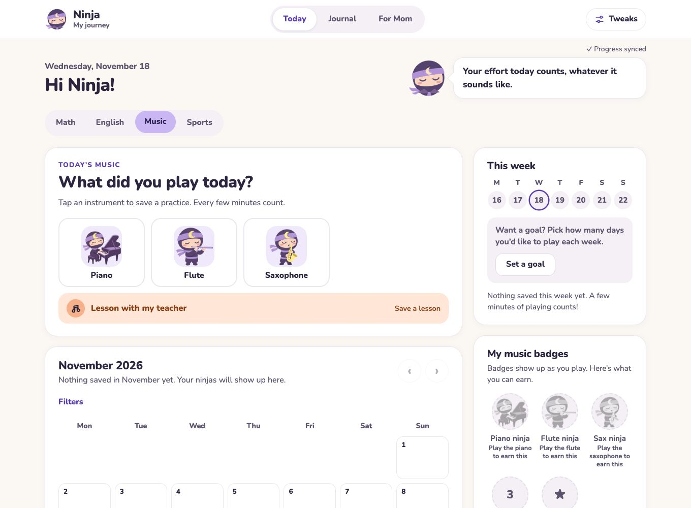

# Ninja Math · Learning Progress Dashboard

**A playful interface for a surprisingly complex problem: turning everyday learning into trustworthy progress.**

Ninja Math is a responsive React and TypeScript application for lesson-based courses and time-based practice. It combines a friendly daily check-in experience with a journal, planning tools, progress visualizations, and a recoverable event history.

**React · TypeScript · Vite · Hono · Cloudflare Workers · D1 · R2 · Zod · Vitest · Playwright**

Built by **[Maria Blair](https://github.com/mashablair)**. The engineering focus is a warm, responsive interface backed by deterministic scheduling rules, shared validation, and recoverable event history.

[Code map](#explore-the-code) · [Run locally](#run-locally) · [Verification notes](docs/PORTFOLIO_CHECK.md)



*Working local test instance with an empty practice history. No live check-ins or individual learning baselines are shown.*

## Product at a glance

- **One interface, two kinds of learning.** Math and English track lessons and partial completion; Music and Sports track activities, minutes, and optional weekly goals.
- **Progress you can understand.** Lesson paths, unit belts, badges, calendars, and weekly summaries turn logs into useful feedback.
- **Separate learning and review.** Completing a lesson, fixing mistakes, and confirming that answers are correct are distinct actions. Review does not accidentally advance the schedule.
- **Room for real life.** Partial work, breaks, corrections, catch-up lessons, and weeks off are represented explicitly rather than hidden inside a progress percentage.
- **A personalized, responsive experience.** Themes, light/dark mode, text size, sound controls, and reduced-motion celebrations adapt the interface to the device and user preferences.

The app is a focused single-learner implementation, not a multi-tenant school platform. Its progress calculations are deterministic; no AI service or API key is required.

## Engineering highlights

### Shared domain logic, thin interfaces

Scheduling, validation, subject models, and event replay live in [`src/domain/`](src/domain). Both the React client and Worker use those rules. Course and practice subjects share their respective projections and UI patterns rather than duplicating a screen for every subject.

### Corrections without losing history

D1 stores append-only events. Edits and removals become new events, and the current state is materialized from the history. Requests include an idempotency key and expected revision; stale writes are rejected instead of silently overwriting newer progress.

Before each accepted write, the Worker saves an event snapshot to private R2 storage. If that backup fails, the write is rejected. A daily scheduled snapshot and an owner-only recovery script provide additional recovery paths.

### Clear client-side responsibilities

The React shell composes separate authentication, data, and UI providers. Loading, save retries, login interruptions, dialogs, and celebrations have explicit responsibilities. Subject-specific wording and artwork are separate from the domain rules.

### Security boundaries that are explicit

The current design allows public reads and protects writes with one shared login. Server-side validation, signed session cookies, same-origin checks, throttling, and security headers support that boundary. This is **not** private learner-data storage: `noindex` is not access control.

## Explore the code

| Area | Responsibility |
| --- | --- |
| [`src/domain/`](src/domain) | Subject types, scheduling, validation, derived progress, event replay |
| [`src/web/`](src/web) | React views, providers, dialogs, themes, sounds, and feedback |
| [`src/server/`](src/server) | Hono API, authentication, security headers, backups |
| [`migrations/`](migrations) | D1 schema changes |
| [`tests/`](tests) | Domain and authentication unit tests, browser flows |
| [`scripts/`](scripts) | Local test server, exports/import helpers, owner recovery |
| [`public/`](public) | Artwork, fonts, and static assets |

The three main views are **Today**, **Journal**, and the planning view currently labeled **For Mom**. Subject settings are defined in `src/domain/student.ts`; encouraging copy lives in `src/web/messages/`.

## Run locally

CI uses Node.js 22. Use that version with the locked Vite and Cloudflare dependencies.

```sh
npm ci
npm run db:local
npm run dev
```

Wrangler uses an isolated local D1 database and R2 store. Deployment does not upload local test data. To exercise authenticated writes, create a git-ignored `.dev.vars` with local-only values for:

```dotenv
AUTH_USERNAME=local-demo
AUTH_PASSWORD=choose-a-local-test-password
SESSION_SECRET=choose-a-random-secret-at-least-32-characters-long
```

Do not reuse production credentials. If Wrangler cannot write its configuration, point `XDG_CONFIG_HOME` at a writable private directory and `WRANGLER_LOG_PATH` at a writable log file. Never commit authentication files.

For portfolio demonstrations, use a separately sanitized local configuration and fictional entries. Do not import live check-ins or publish screenshots of actual learner records. The repository's current subject settings include deployment-specific baseline values; an empty local database alone does not turn those into fictional data.

## Tests and quality checks

```sh
npm run typecheck
npm test
npx playwright install chromium   # first browser-test setup
npm run test:e2e
npm run check                    # typecheck + unit + browser tests
```

Unit tests cover scheduling, cumulative partial completion, corrections, validation, review status, badges, weekly leagues, and authentication. Playwright exercises the login gate and check-in/edit/remove flows for all four subjects, including planning and review interactions.

The browser suite starts a production build on port `8790`, with its own database in `.wrangler/e2e` and test-only credentials. It does not write to production or the normal local database. See [`playwright.config.js`](playwright.config.js) and [`scripts/e2e-server.mjs`](scripts/e2e-server.mjs).

GitHub Actions is configured to run the checks on pushes to `main` and pull requests. Test configuration describes intended coverage; consult the latest run for pass/fail results.

## Domain rules worth preserving

- Lesson completion is cumulative per lesson, not an additive ledger of fractions.
- Unknown catch-up work remains incomplete until explicitly confirmed.
- Forecasts use remaining lesson-equivalents, rounded up, and weekday scheduling in the configured timezone. Extra and weekend work count.
- A follow-on course begins after its prerequisite finishes. Actual completion dates remain fixed after completion.
- Unlogged days stay unlogged rather than becoming automatic skips.
- Review checks and fix-up entries do not add lesson progress or advance forecasts. Unit belts require both completion and review.
- Optional practice goals count days per week, not streaks. Practice badges are derived from recorded work, not invented achievements.
- Weeks marked off are excluded from weekly league movement. Feedback should stay kind and specific, and gentler feedback remains available.

Keep changes in the shared domain layer and update the corresponding tests rather than reimplementing these rules in a view.

## Cloudflare deployment

The Worker serves both the application and API. [`wrangler.jsonc`](wrangler.jsonc) defines D1, the private R2 bucket, custom-domain routes, and the daily cron.

For an **existing deployment**, use its recorded resources and set `AUTH_USERNAME`, `AUTH_PASSWORD`, and `SESSION_SECRET` as Worker secrets. Do not recreate the database or bucket on every deploy.

```sh
npm run db:remote   # applies migrations to the configured remote database
npm run deploy     # builds, then deploys the Worker and its assets
```

These commands change remote infrastructure or the live application. For a new deployment, first authenticate with Wrangler, create your own D1 database and private R2 bucket, and update the resource identifiers and routes. Do not deploy a fork with someone else's resource configuration.

Always build before deploying. Vite produces the client and Worker output plus a generated deployment configuration. The configured `main` build runs unit tests and a build before deployment.

## Backups and owner recovery

- Pre-write snapshots: `before-change/YYYY-MM-DD/<uuid>.json`
- Daily snapshots: `daily/YYYY-MM-DD.json`, scheduled at `07:00 UTC`
- Snapshots are retained; no automated deletion is configured.
- Public API routes cannot read/delete R2 backups or restore progress.
- **Download progress** exports a portable JSON copy without replacing automatic backups.

Recovery requires the owner's Cloudflare access:

```sh
mkdir -p backups
npx wrangler r2 object get ninja-math-backups/daily/YYYY-MM-DD.json --remote --file backups/snapshot.json
node scripts/restore.mjs backups/snapshot.json                  # preview only
node scripts/restore.mjs backups/snapshot.json --apply --remote # changes remote data
```

Review the preview before applying. The apply step exports a pre-restore SQL backup locally and appends recovery events; it does not erase the original event history. The script also accepts an exported progress JSON file. Pause writes while recovering if concurrent changes are possible. Keep exports private and monitor scheduled backup failures in Cloudflare observability.

`npm run pull:live` is an owner maintenance tool that replaces the **local** database with live public check-ins. It is not a demo-data generator and should not be used for portfolio screenshots.

## Scope and privacy

This README intentionally omits individual learning baselines, targets, and schedules. That is a documentation change, **not a repository-wide privacy audit**. Review code, history, assets, exports, and any deployed data separately before repurposing this project for another learner or sharing a demonstration.

Future AI assistance would need authorized server-side routes, usage controls, and an appropriate child-facing design. Scheduling and progress arithmetic should remain independent of model responses.
